# Aggregates a Fenwick Tree Cannot Support

**CS253 / MA253 – Project 5 – Report**

21 November 2026

## Abstract

We study point assignments and range aggregates for a sensor array. A segment tree maintains maximum, its frequency and greatest common divisor (GCD); a two-tree Fenwick structure supports arbitrary range maxima. We describe their invariants, an array oracle, adversarial inputs and measurements. The recorded experiments demonstrate that performance depends on the operation mix and range width. Integration and cache-measurement limitations are stated explicitly.

## 1. Team and contributions

| Role | Teammate | Roll number | GitHub | Derivation |
| --- | --- | --- | --- | --- |
| Structure A owner | Tia Mehra | 250041039 | @Tia-917 | D1 |
| Structure B owner | Vishruth Agrawal | 250001078 | @Vishruth-create | D2 |
| Architect | Anushri Maheshwari | 250041005 | @Apples-17 | D3 |
| Oracle owner | Sushmita Patil | 250001069 | @psush29 | D4 |
| Adversary | Vanshika Agrawal | 250001076 | @vanshi040907 | D5 |
| Analyst | Adi Jain | 250001083 | @AdiJainS | D6 |

What each member built, with links to main commits (pull requests are listed in the repository's Pull requests tab):

- **Tia Mehra (Structure A):** generic iterative segment tree core ([451757b](https://github.com/AdiJainS/Aggregates-A-Fenwick-Tree-Cannot-Support/commit/451757b)), maximum/count and gcd wrapper ([0ebb69f](https://github.com/AdiJainS/Aggregates-A-Fenwick-Tree-Cannot-Support/commit/0ebb69f)), query, update, invariant and differential tests ([b72444b](https://github.com/AdiJainS/Aggregates-A-Fenwick-Tree-Cannot-Support/commit/b72444b)), operation counters ([10d8e8e](https://github.com/AdiJainS/Aggregates-A-Fenwick-Tree-Cannot-Support/commit/10d8e8e)), pull request 5.
- **Vishruth Agrawal (Structure B):** Fenwick maximum build and query ([ec8e003](https://github.com/AdiJainS/Aggregates-A-Fenwick-Tree-Cannot-Support/commit/ec8e003)), assign with decreases ([4bd8733](https://github.com/AdiJainS/Aggregates-A-Fenwick-Tree-Cannot-Support/commit/4bd8733)), prefix-only baseline ([09e2867](https://github.com/AdiJainS/Aggregates-A-Fenwick-Tree-Cannot-Support/commit/09e2867)), O(log n) assign with the slow version kept as a cross-check ([9b3aa9d](https://github.com/AdiJainS/Aggregates-A-Fenwick-Tree-Cannot-Support/commit/9b3aa9d)), counters and their tests ([c06eb48](https://github.com/AdiJainS/Aggregates-A-Fenwick-Tree-Cannot-Support/commit/c06eb48), [e925e6f](https://github.com/AdiJainS/Aggregates-A-Fenwick-Tree-Cannot-Support/commit/e925e6f)), D2 derivation, pull request 3.
- **Anushri Maheshwari (Architect):** sensor replay application and gcd segment tree ([380085c](https://github.com/AdiJainS/Aggregates-A-Fenwick-Tree-Cannot-Support/commit/380085c), [06784fb](https://github.com/AdiJainS/Aggregates-A-Fenwick-Tree-Cannot-Support/commit/06784fb)), seeded tests and invariant checks ([8bce4a7](https://github.com/AdiJainS/Aggregates-A-Fenwick-Tree-Cannot-Support/commit/8bce4a7)), interface document and D3 proof ([1412acf](https://github.com/AdiJainS/Aggregates-A-Fenwick-Tree-Cannot-Support/commit/1412acf)), pull requests 4 and 8.
- **Sushmita Patil (Oracle):** array oracle ([3e9e658](https://github.com/AdiJainS/Aggregates-A-Fenwick-Tree-Cannot-Support/commit/3e9e658)), seeded operation generator ([466834b](https://github.com/AdiJainS/Aggregates-A-Fenwick-Tree-Cannot-Support/commit/466834b)), gcd reference and differential testing ([e85a02a](https://github.com/AdiJainS/Aggregates-A-Fenwick-Tree-Cannot-Support/commit/e85a02a), [2133306](https://github.com/AdiJainS/Aggregates-A-Fenwick-Tree-Cannot-Support/commit/2133306)), million-operation D2 test ([95db6b8](https://github.com/AdiJainS/Aggregates-A-Fenwick-Tree-Cannot-Support/commit/95db6b8)), failure shrinking ([f7ded3e](https://github.com/AdiJainS/Aggregates-A-Fenwick-Tree-Cannot-Support/commit/f7ded3e)), D4 proof, pull request 6.
- **Vanshika Agrawal (Adversary):** repeated-rebuild workload ([6f551e8](https://github.com/AdiJainS/Aggregates-A-Fenwick-Tree-Cannot-Support/commit/6f551e8)), difficult queries ([6005783](https://github.com/AdiJainS/Aggregates-A-Fenwick-Tree-Cannot-Support/commit/6005783)), repeated decreases ([4b820b9](https://github.com/AdiJainS/Aggregates-A-Fenwick-Tree-Cannot-Support/commit/4b820b9)), scale verification ([ff61b0b](https://github.com/AdiJainS/Aggregates-A-Fenwick-Tree-Cannot-Support/commit/ff61b0b)), D5 proof, pull request 2.
- **Adi Jain (Analyst):** cost model draft ([f1ec232](https://github.com/AdiJainS/Aggregates-A-Fenwick-Tree-Cannot-Support/commit/f1ec232)), gcd and maximum benchmarks ([ec9b31f](https://github.com/AdiJainS/Aggregates-A-Fenwick-Tree-Cannot-Support/commit/ec9b31f), [60da2c5](https://github.com/AdiJainS/Aggregates-A-Fenwick-Tree-Cannot-Support/commit/60da2c5)), D5 scale benchmarks ([9819241](https://github.com/AdiJainS/Aggregates-A-Fenwick-Tree-Cannot-Support/commit/9819241)), decrease study ([9f259e7](https://github.com/AdiJainS/Aggregates-A-Fenwick-Tree-Cannot-Support/commit/9f259e7)), counters-off reruns ([a9cc82f](https://github.com/AdiJainS/Aggregates-A-Fenwick-Tree-Cannot-Support/commit/a9cc82f)), pull requests 1 and 7.

## 2. Problem

The application stores sensor readings and calibration values and processes point assignments and range queries. The architect’s interface uses zero-based half-open ranges $[l,r)$, with $0 \le l \le r \le n$. A query returns the maximum reading, its count, and the GCD of calibration values. Empty queries return $(-1,0,0)$ under the application’s nonnegative input contract. The application accepts separate reading and calibration fields. The application now uses the native structures through the shared adapters in `include/`. Structure B promises a maximum only, so a hybrid implementation must identify how it supplies count and GCD.

Scale: one million values and one million operations (n up to 1,048,576 for the D5 workloads), as required by the project document.

## 3. Interface and invariants

The full text is in [INTERFACE.md](INTERFACE.md). Part 1 lists the structure interface (build, assign, maximum query, gcd query) and the half-open versus inclusive range conventions. Structure A uses half-open ranges `[l, r)`; Structure B and the maximum oracle use inclusive ranges `[l, r]`, and the benchmark harness converts between them. Part 2 is the application contract for the sensor replay.

Invariants checked by tests:

1. Every query equals the plain-array answer after any sequence of assignments (`oracle/`, `tests/differential_test.cpp`).
2. Structure A: every parent equals the merge of its children; padding leaves are identities (`tests/structA/test_invariants.cpp`).
3. Structure B: every stored block equals the true maximum of its block, including after a decrease; the fast assignment leaves the same blocks as a fresh build (`tests/structB/test_blocks.cpp`).
4. Structure B: a query visits at most 2·⌊log₂ n⌋+1 blocks and an assignment takes at most 4(⌊log₂ n⌋+1) steps (`tests/structB/test_counters.cpp`).
5. The prefix baseline is correct after a decrease only because it rebuilds.

## 4. Structure A

Each leaf holds a value. Internal nodes merge their children: maximum/count selects the larger maximum and adds counts on ties, while GCD uses Euclid’s algorithm with identity zero. Padding leaves use identities. The implementation stores separate maximum/count and GCD trees. A point assignment replaces a leaf and recomputes its ancestors; a query combines disjoint blocks covering the requested range. By induction each node contains the correct aggregate. Build and storage are $O(n)$ for maximum/count; maximum query and update are $O(\log n)$.

For D1, the pair for a sequence is its maximum and the number of occurrences of that maximum. Merging two pairs produces exactly the pair for their concatenation. Concatenation is associative, so the merge is associative; $(-\infty,0)$ is its identity. The segment-tree argument needs associativity and an identity, not an inverse. Two accumulators preserve left-to-right order for generic associative operations.

More explicitly, for summaries $(m_1,c_1)$ and $(m_2,c_2)$, let $M=\max(m_1,m_2)$. Their merge is $(M,[m_1=M]c_1+[m_2=M]c_2)$. For any three summaries, either grouping produces the overall maximum and adds exactly the counts belonging to it. Thus the operation is associative and the empty summary is an identity. A range query repeatedly takes complete nodes from its left or right boundary; the selected nodes and the unprocessed middle partition the original interval. When the middle is empty, the ordered accumulators cover every requested element once. This proof works for any monoid, including a noncommutative one, because the implementation preserves order.

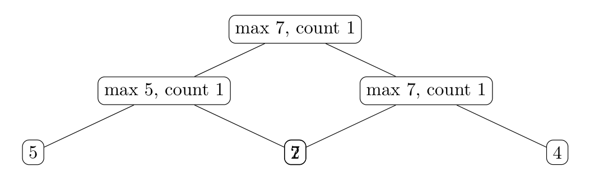

*Figure 1: Segment tree for readings [5, 2, 7, 4]. Each parent combines its children.*

## 5. Structure B

The implementation stores maxima for blocks in two directional Fenwick arrays. An arbitrary range is covered from both boundaries using stored blocks and remaining elements. Reversing comparisons turns the range-minimum method of Dima and Ceterchi into a maximum method. The project implementation scans blocks during construction, with an $O(n \log n)$ upper bound; query work is $O(\log(w+1))$ for range width $w$. The D2 derivation bounds this implementation’s assignment steps by $4(\lfloor\log_2 n\rfloor+1)$, giving $O(\log n)$ worst-case steps. Counters distinguish query blocks, assignment steps and changed blocks; these measure different events.

For one-based internal index $i$, write lowbit$(i)$ for its lowest set bit. The first tree stores the maximum on $[i-\text{lowbit}(i)+1,i]$; the second stores the maximum on $[i,\min(n,i+\text{lowbit}(i)-1)]$. The invariant says each stored value is the true maximum of its block. The query walks from both endpoints toward the unique position with the largest lowbit in the range. The blocks visited from the left cover the positions before that point; those from the right cover the positions after it; the remaining position is read directly. Thus their union is the requested range without gaps. Each successive lowbit at least doubles, so each walk has at most $\lfloor\log_2 w\rfloor$ steps.

For an assignment, unaffected blocks retain their maxima. The update recomputes affected blocks using partial maxima from their unchanged parts and the new value, including when the old maximum is decreased. The D2 proof states the block invariant and gives the detailed walk-by-walk argument in <code>docs/derivations/sources/D2-structureB-draft.md</code>. The bound concerns its counted algorithmic steps; it is not a claim that every update takes the same elapsed time.

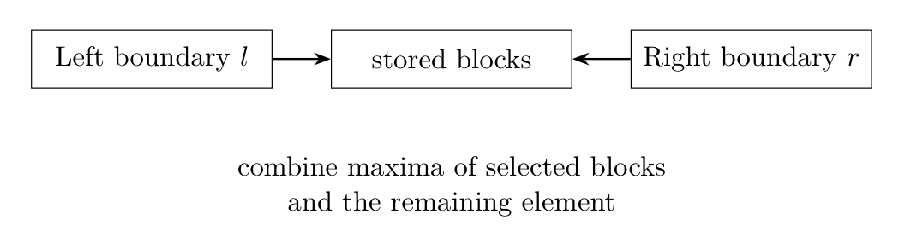

*Figure 2: Structure B covers a requested range by traversing blocks from both ends.*

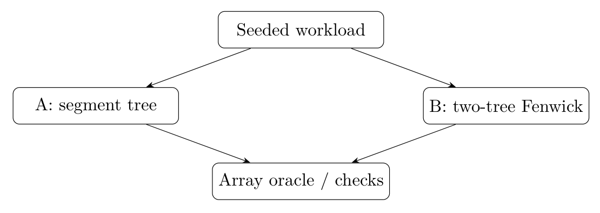

*Figure 3: The same generated workload is replayed for A and B; manageable cases are checked against the oracle.*

### 5.1 Design decisions and rejected alternatives

- **Two arrays instead of one.** A single Fenwick array of blocks ending at each index only answers prefix queries. Adding the second array of blocks starting at each index lets a query walk in from both ends and cover any range.
- **Recompute affected blocks instead of `max(stored, v)`.** The increase-only update is wrong after a decrease, because a block whose old maximum was the changed element keeps a value that is too large. We rebuild each affected block from the new value and the unchanged parts on either side of it.
- **Two climbs before any write, instead of range queries per block.** `assignSlow` recomputes each affected block with two range queries, which costs O(log n) per block and O(log² n) per update. The fast `assign` records running maxima in two climbs and then writes every block once, giving O(log n). We kept `assignSlow` as a cross-check; `tests/structB/test_blocks.cpp` compares the two against a fresh build.
- **No whole-array rebuild on a decrease.** The prefix-only baseline rebuilds in O(n) on every decrease. Structure B avoids this, which is the point of keeping both arrays.

### 5.2 Why a prefix maximum is insufficient

Prefix maxima cannot be subtracted to recover an arbitrary range maximum. For example, $[10,2]$ and $[10,7]$ have identical prefix maxima but different maxima at the second position. The prefix-only baseline supports prefix queries; in this implementation each decrease rebuilds the tree. Increasing a value visits logarithmically many blocks, but decreasing an old maximum can hide the replacement. Rebuilding makes two linear passes.

For D4, the failed step is the cancellation used in a sum query: from $P(r)=P(l-1)+S(l,r)$ we recover $S(l,r)$ by subtracting $P(l-1)$. Maximum has no corresponding inverse capable of recovering the missing range maximum. The counterexample above gives the same two prefix answers for two different range answers.

## 6. The requirement beyond the lecture

The reading-list part of this project is the Fenwick range-maximum structure of Dima and Ceterchi [2], implemented in `src/structB/fenwick_max.hpp` (class `FenwickMax`). It keeps two Fenwick-style arrays, one with blocks ending at each index and one with blocks starting at each index, and covers a requested range from both ends. We turned the range-minimum method into a maximum method by reversing the comparisons.

Where our implementation differs from the paper:

- Build: the implementation scans each block, giving an O(n log n) upper bound. The paper describes a linear build.
- Updates: the paper's setting is mainly queries; our project requires point assignment including decreases. `assign` recomputes only the blocks that contain the changed index, using partial maxima of their unchanged parts, in O(log n) steps. The older `assignSlow` is kept as a cross-check (`tests/structB/test_blocks.cpp`).
- Counters: the class counts query blocks, assignment steps, changed blocks and lowered blocks. These are an addition for the measurements.

The paper sketches the update as amortized O(log N) without a full proof. D2 (`docs/derivations/D2_250001078.pdf`) instead proves the query bound 2⌊log₂ w⌋+1 blocks and a direct worst-case bound of 4(⌊log₂ n⌋+1) steps for `assign`, so no amortised argument is needed.

## 7. Correctness

The array oracle performs assignments directly and scans a query range to calculate maximum, count and GCD. Differential tests replay the same operations against the structures and compare results; the D4 work also includes a shrinker for failing sequences. A uses half-open ranges while the general oracle uses inclusive endpoints, so the harness adjusts endpoints at the boundary. Small random cases and adversarial workloads are checked against the oracle; large timing checksums detect disagreement but do not prove correctness.

An oracle query scans $w$ values and an assignment changes one array entry. The oracle’s simplicity makes it useful for checking each output, including repeated equal maxima and decreases. The D4 tests use a recorded random seed so a failure can be reproduced, and preserve failing operations for investigation. The shrinker removes operations while maintaining a failure, yielding a shorter example; it is a debugging aid, not a proof that the remaining implementations are correct for all inputs. The D4 derivation also shows that $\max(10,3)=\max(10,9)=10$: even knowing the old prefix maximum and combined maximum cannot recover the hidden range maximum.

The differential tests are run by `make test`:

| Test | Operations | Seed | Result |
| --- | ---: | ---: | --- |
| Structure B against the oracle (`tests/test_scale_d2.cpp`) | 1,000,000 | 42 | PASS, 0 mismatches |
| Structure A against the oracle (`tests/structA/test_differential.cpp`) | 1,000,000 | 20261116 | PASS |
| Structure A against the oracle (`tests/test_real_d1.cpp`) | 100,000 | 42 | PASS |
| Application, both backends (`bin/app --backend=a --test`, `--backend=b-hybrid --test`) | 1,000,000 each | 253 | PASS |
| Shrinker demonstration (`tests/test_shrink_real_d2.cpp`) | injected fault, 5 operations reduced to 2 | — | detected |

### 7.1 Bug log

| Date | Module | Symptom | Found by | Fixing commit |
| --- | --- | --- | --- | --- |
| 2026-11-16 | Structure B (injected fault) | Omitted `ASSIGN 4 6` left index 4 at 8, so query `[3,4]` returned 8 instead of 6; the shrinker reduced 5 operations to 2. This fault was injected into the harness on purpose and is not a bug in the production code. | D4 differential shrinker | [f7ded3e](https://github.com/AdiJainS/Aggregates-A-Fenwick-Tree-Cannot-Support/commit/f7ded3e) (demonstration only); also in `docs/BUG_LOG.md` |

TODO (every owner): add to this table (and `docs/BUG_LOG.md`) real bugs only, from your own notes and the commit history. Examples to look for: the Structure B assign rewrite ([9b3aa9d](https://github.com/AdiJainS/Aggregates-A-Fenwick-Tree-Cannot-Support/commit/9b3aa9d)), the segment-tree debug-check fix ([37f797e](https://github.com/AdiJainS/Aggregates-A-Fenwick-Tree-Cannot-Support/commit/37f797e)), and any mismatch the oracle reported. Do not add entries that did not happen.

## 8. Adversarial inputs

For $n=2^h$, the D5 difficult-query generator selects a range that makes the two-tree implementation count $2h-1$ query blocks. Its repeated-decrease workload repeatedly lowers a unique maximum and forces stored maxima to change. For $h=20$, one million difficult queries produce 39 million query blocks. A workload of 500,000 decreases and 500,000 queries produces 21 million assignment steps, 11 million lowered blocks and 10.5 million query blocks. These are implementation-specific counts, not elapsed times. The generators and proof appear in <code>adversary/ANALYSIS.md</code>.

For the prefix baseline, consider $[5,3]$. Its full-prefix maximum is 5. After assigning the first element to 1, the correct maximum is 3, but applying the increase-only rule $T[i] := \max(T[i],1)$ leaves the stale maximum 5. D5 constructs a sequence of strict decreases to the first element; the baseline implementation rebuilds on every assignment. This gives $\Theta(kn)$ rebuild work for $k$ decreases, in addition to initial construction. The two-tree difficult-query and update counts are different adversarial targets: lowering stored maxima and visiting blocks are tracked separately.

## 9. Predicted cost model

The model was written before measuring. Its first commit is [f1ec232 "Draft cost model"](https://github.com/AdiJainS/Aggregates-A-Fenwick-Tree-Cannot-Support/commit/f1ec232) (10 November 2026); the first measurement files (`results/`) were committed on 16 November 2026. The final model is in `docs/derivations/D6_250001083.pdf`, with its notes in `docs/derivations/sources/D6-analyst-draft.md`.

For the prefix baseline, if $Q$ queries, $U_+$ nondecreasing updates and $U_-$ decreases are replayed, rebuilding on each decrease gives

$$
O(n+Q\log n+U_+\log n+nU_-).
$$

An array assignment is $O(1)$ while a scan takes $O(w)$ for range width $w$. A’s aligned full-range query may be cheaper than a medium range even though the worst-case bound is logarithmic.

## 10. Experimental setup

The 20 November measurements use an Intel Core i9-13900HX, Windows 11, Zig 0.13.0 / Clang 18.1.6 and C++17 with <code>-O2</code>. Both structures have counters disabled in timing builds; counters are collected separately. The random workload uses one million values, one million operations and seed 253. Construction is measured separately from replay. Each timing is the mean and sample standard deviation of five runs. The machine was interactive, with no recorded thermal or background-load isolation.

This report describes repository main at commit <code>67f55ee</code>, fetched on 21 November 2026. Benchmark results retain the source revisions recorded with each measurement; they should not be attributed automatically to later versions.

## 11. Results

| Width | Updates | A (ms) | B (ms) |
| ---: | ---: | ---: | ---: |
| 1 | 10% | 53.41 ± 0.66 | 68.88 ± 0.81 |
| 1 | 50% | 168.79 ± 4.01 | 303.32 ± 7.58 |
| 1 | 90% | 315.79 ± 65.31 | 619.32 ± 116.14 |
| 1,024 | 10% | 215.51 ± 6.58 | 143.16 ± 4.87 |
| 1,024 | 50% | 271.82 ± 17.20 | 376.30 ± 46.82 |
| 1,024 | 90% | 341.94 ± 44.03 | 624.30 ± 92.48 |
| 1,000,000 | 10% | 77.32 ± 0.51 | 86.25 ± 2.65 |
| 1,000,000 | 50% | 189.07 ± 3.17 | 329.44 ± 10.12 |
| 1,000,000 | 90% | 326.85 ± 55.80 | 633.75 ± 104.31 |

*Table 1: Random maximum replay: counters-off runs. The spread is sample standard deviation.*

For width 1024 and 10% updates, B is faster in this set. The nine configurations show how the outcome varies with width and update mix. Some update-heavy runs have substantial spread. The measurements do not isolate the causes or establish a universal winner.

In D5’s million-operation workloads, difficult queries took 76.12 ± 1.01 ms for A and 37.47 ± 0.53 ms for B. The interleaved decrease/query workload took 45.59 ± 0.09 ms for A and 84.92 ± 4.28 ms for B. Each workload was checked against its deterministic expected answers.

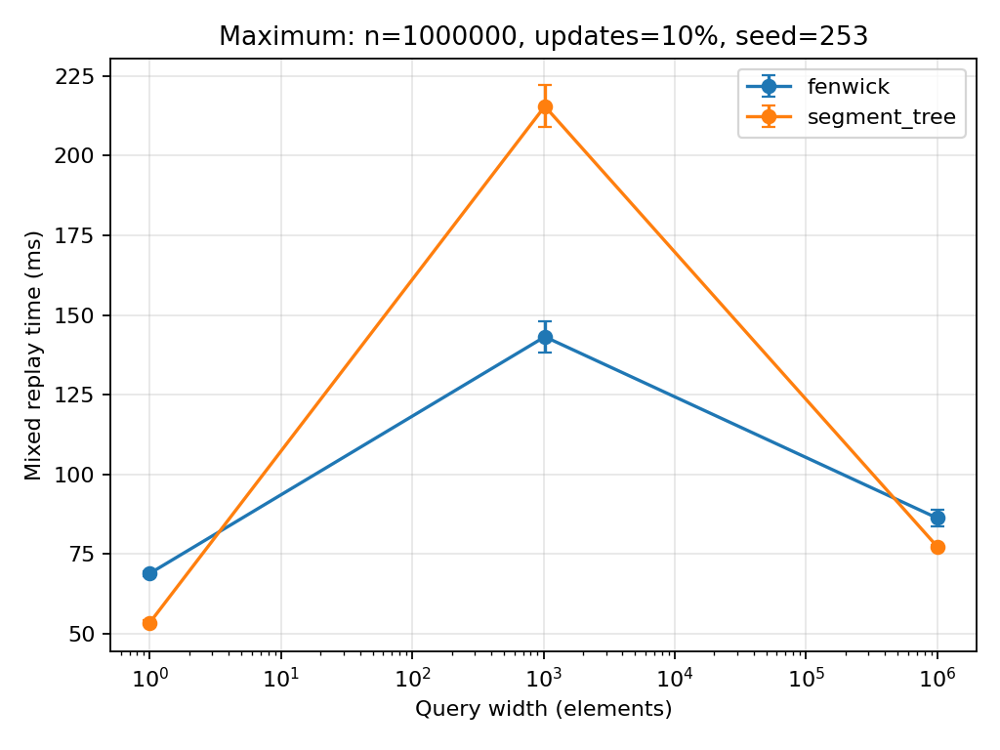

*Figure 4: Replay time versus width, 10% updates.*

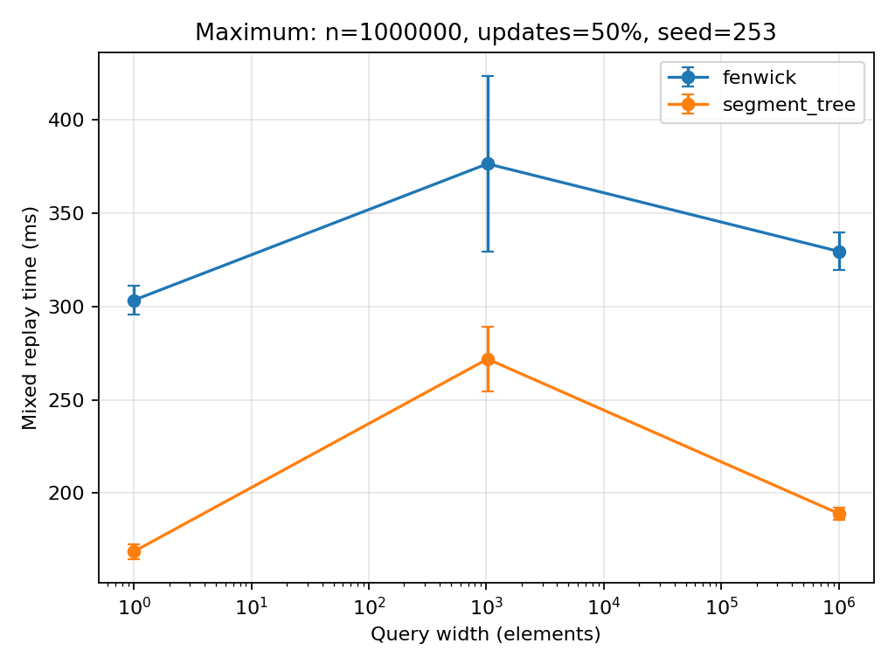

*Figure 5: Maximum replay time versus width, 50% updates.*

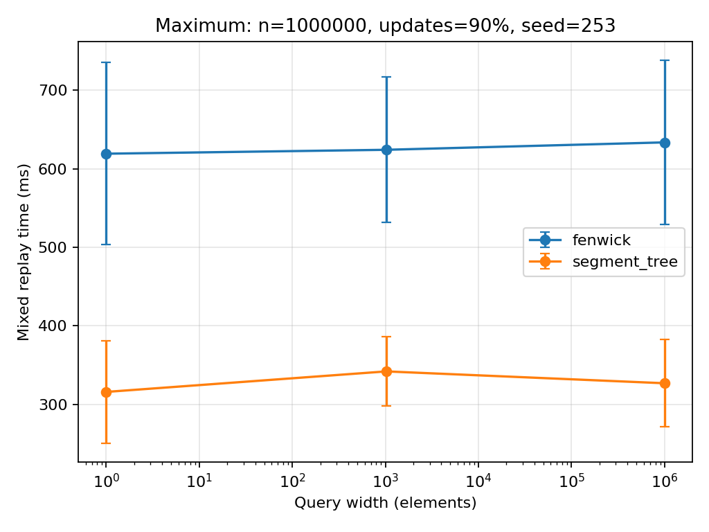

*Figure 6: Maximum replay time versus width, 90% updates.*

### 11.1 Varying the share of decreases

The full decrease sweep covers three widths, three update shares and three requested decrease shares. At width 1024 and 50% updates, the 0%, 50% and 100% decrease cases took respectively 276.21 ± 19.36, 254.75 ± 5.04 and 251.89 ± 4.83 ms for A, and 381.21 ± 58.67, 372.38 ± 59.38 and 375.50 ± 57.00 ms for B. These are full replay times, not isolated decrease costs. B’s spread is large and the measurements do not establish a clear decrease-rate trend for B.

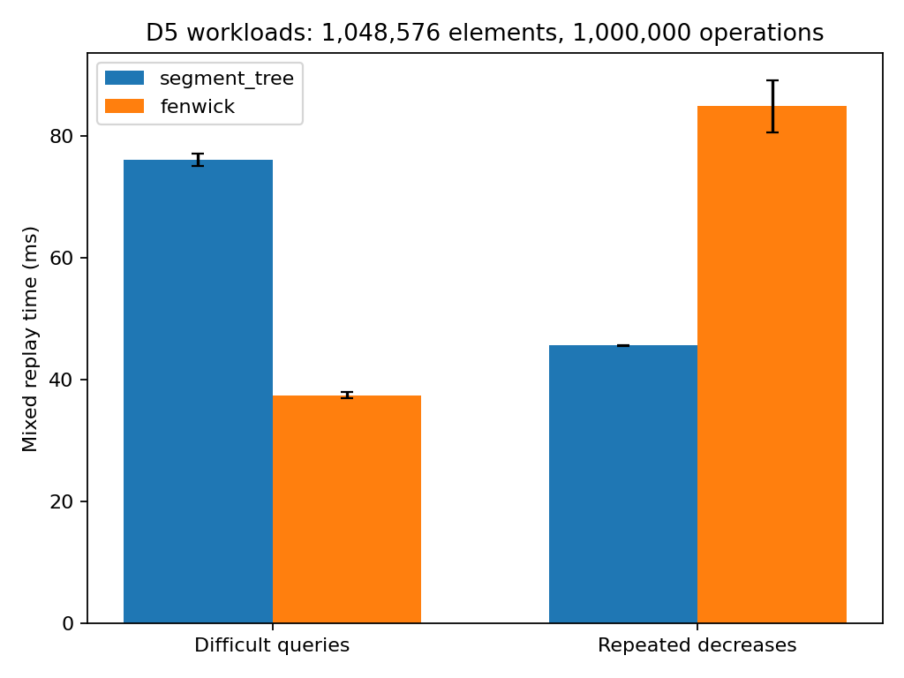

*Figure 7: D5 adversarial workload replay timings; $n=1{,}048{,}576$.*

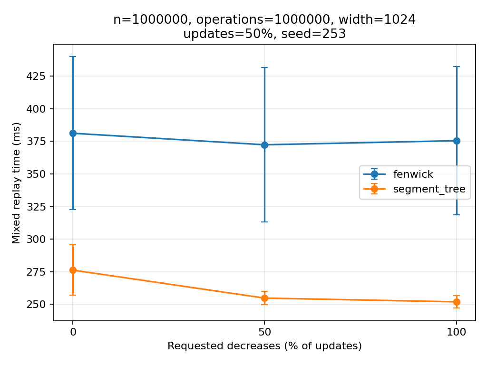

*Figure 8: Full-scale decrease sweep, width 1024 and 50% updates.*

The prefix baseline was measured at $n=4096$ with 10,000 operations and 50% updates. With 0, 2,532 and 5,051 actual decreases, replay time was respectively 0.23, 14.12 and 27.84 ms. The rising trend is consistent with the rebuild term, but one fixed-size experiment does not prove an asymptotic bound.

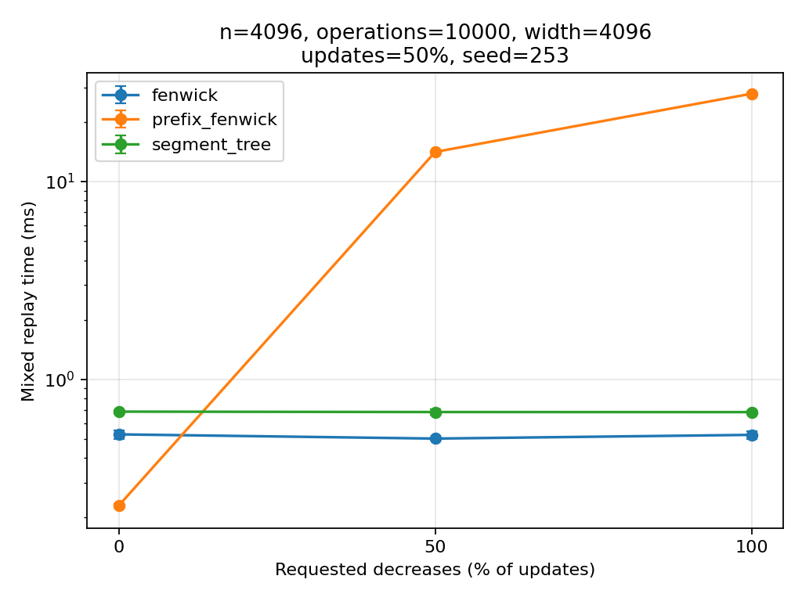

*Figure 9: Prefix baseline replay versus decrease share.*

### 11.2 GCD benchmark

The GCD benchmark used the D1 GCD tree and D4 array reference, with one million values and operations and seed 253. The following results are from the 17 November D1 update set, distinct from the 20 November maximum timings. Every entry is a five-run replay mean in milliseconds with sample standard deviation. The oracle was timed only at width 1; wider ranges were not timed against the array because scanning them is expensive. A dash denotes an unmeasured case, not zero time.

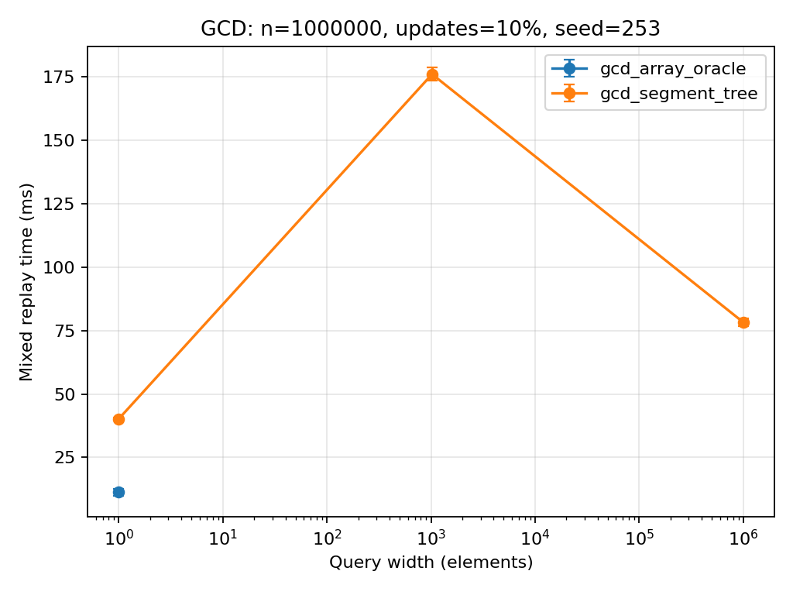

*Figure 10: GCD replay versus width, 10% updates.*

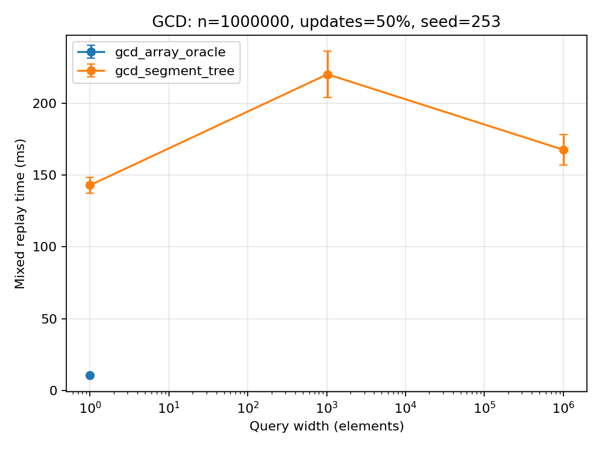

*Figure 11: GCD replay versus width, 50% updates.*

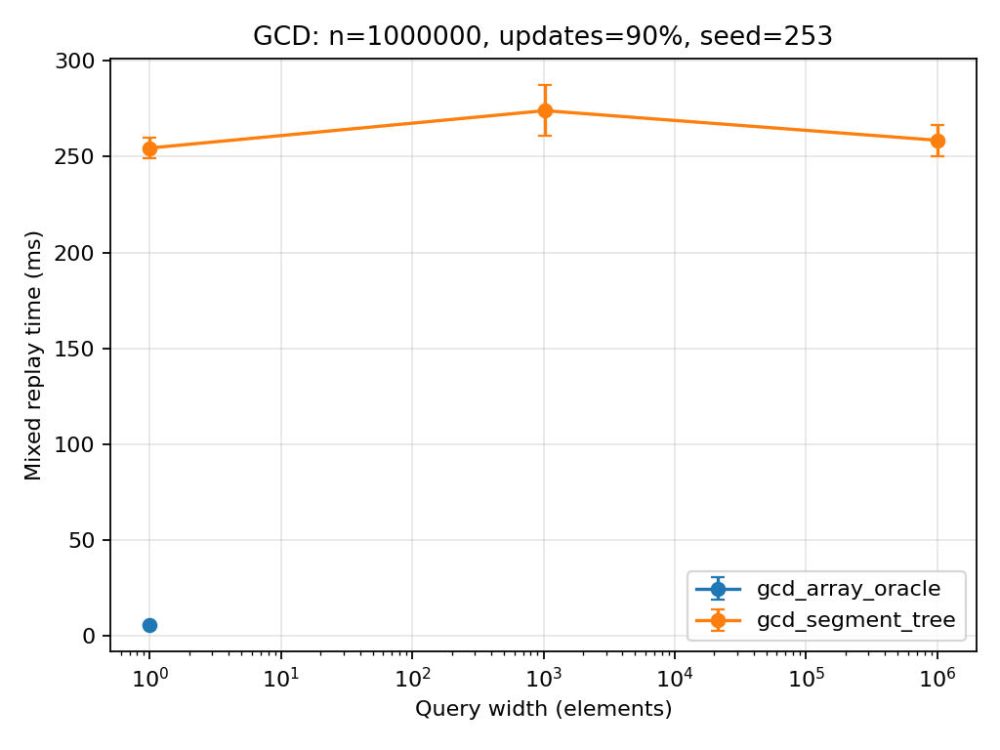

*Figure 12: GCD replay versus width, 90% updates.*

| Width | Updates | GCD tree (ms) | Array oracle (ms) |
| ---: | ---: | ---: | ---: |
| 1 | 10% | 40.20 ± 0.57 | 11.23 ± 1.31 |
| 1 | 50% | 142.99 ± 5.38 | 10.42 ± 0.13 |
| 1 | 90% | 254.50 ± 5.38 | 5.97 ± 0.10 |
| 1024 | 10% | 176.08 ± 2.57 | — |
| 1024 | 50% | 220.24 ± 16.01 | — |
| 1024 | 90% | 274.00 ± 13.20 | — |
| 1,000,000 | 10% | 78.30 ± 1.42 | — |
| 1,000,000 | 50% | 167.70 ± 10.73 | — |
| 1,000,000 | 90% | 258.54 ± 8.21 | — |

*Table 2: GCD replay measurements from 17 November.*

### 11.3 Operation counters

In the earlier separate GCD counter run at width 1024 and 50% updates, the tree selected 4,996,370 query blocks and performed 21,055,611 Euclidean remainder steps across replay. The latter excludes construction. The 511,597,568 array elements for the same query widths are a calculated scan count, not a measured oracle run. These counters use the earlier GCD workload and cannot be assumed to describe the later maximum timing runs.

### 11.4 Cache profiling

Separate Windows Performance Recorder traces were examined for the benchmark process. The newer traces show 1,568 A samples and 4,892 B samples under the thread-ID filter; a stricter lifetime filter gives 4,891 for B. These are sampled events, not exact totals or miss rates. The traces include preparation, construction and 20 replays, use counters enabled for B, and differ in process duration. They do not explain the timing difference or establish a cache-performance ranking. Source hashes, filters and trace summaries are documented in <code>results/raw/cache/README.md</code>.

### 11.5 Figure provenance

| Figure | Script | Raw data |
| --- | --- | --- |
| 1 to 3 | drawn for the report | none |
| 4 to 6 | `bench/plot_width.py` | `results/raw/timing-2026-11-20/max-summary.csv` |
| 7 | `bench/plot_d5.py` | `results/raw/timing-2026-11-20/d5-summary.csv` |
| 8 | TODO (Adi): script not recorded | `results/raw/timing-2026-11-20/decreases/summary.csv` |
| 9 | `bench/plot_decreases.py` | `results/raw/timing-2026-11-20/decreases/prefix-summary.csv` |
| 10 to 12 | `bench/plot_width.py` | `results/raw/gcd-summary.csv` |

`scripts/run_all.sh` regenerates figures 4 to 7 and 9. TODO (Adi): add error bars to figure 8 and any figure that lacks them, as the guidelines require.

## 12. Limitations

The benchmarked source revisions are documented with the raw CSVs and scripts in <code>results/raw/timing-2026-11-20/</code>. Confirm the team’s final release revisions, rerun affected checks if code changes. The original derivations and tools declarations remain in their respective repository directories. Cache traces are ignored by Git; the summaries are committed. The 20 November runs retain observed spread and should not be presented as thermally controlled measurements.

The brief asks for all approaches across width and update mix. The committed GCD oracle timings cover width one; wider GCD cases measure the tree only. The array scan model predicts width-dependent work, but the available timings do not establish that trend experimentally. Complete the missing oracle measurements where feasible, or explicitly retain this limitation in the submission.

Other limitations: `bin/app` runs on the native structures (`--backend=a` or `--backend=b-hybrid`), but the hybrid takes count and gcd from A because B does not provide them; there is no `run_ops --structure A|B` evaluation binary; `REPORT.pdf` and `docs/slides/slides.pdf` are not yet exported or committed. Next measurements: rerun everything on one machine with counters off for both structures, add the array oracle at wider ranges, and take cache measurements with the same code and settings.

## 13. References

[1] P. M. Fenwick, “A New Data Structure for Cumulative Frequency Tables,” *Software: Practice and Experience*, 24(3), 1994. https://doi.org/10.1002/spe.4380240306.

[2] M. Dima and R. Ceterchi, “Efficient Range Minimum Queries using Binary Indexed Trees,” *Olympiads in Informatics*, 9, 2015. https://ioinformatics.org/oi/pdf/v9_2015_39_44.pdf.

[3] CS253 / MA253, *Lab Project Descriptions*, Project 5, 2026.

[4] M. de Berg, O. Cheong, M. van Kreveld and M. Overmars, *Computational Geometry: Algorithms and Applications*, 3rd ed., Springer, 2008, Chapter 10.

[5] J. L. Bentley, "Decomposable searching problems," *Information Processing Letters* 8(5):244–251, 1979.

[6] D. E. Knuth, *The Art of Computer Programming*, Vol. 2, 3rd ed., Addison-Wesley, 1997, §4.5.3.

[7] cp-algorithms.com, "Segment Tree" and "Fenwick Tree" (study material).

[8] Tools used are declared in [TOOLS.md](TOOLS.md).
